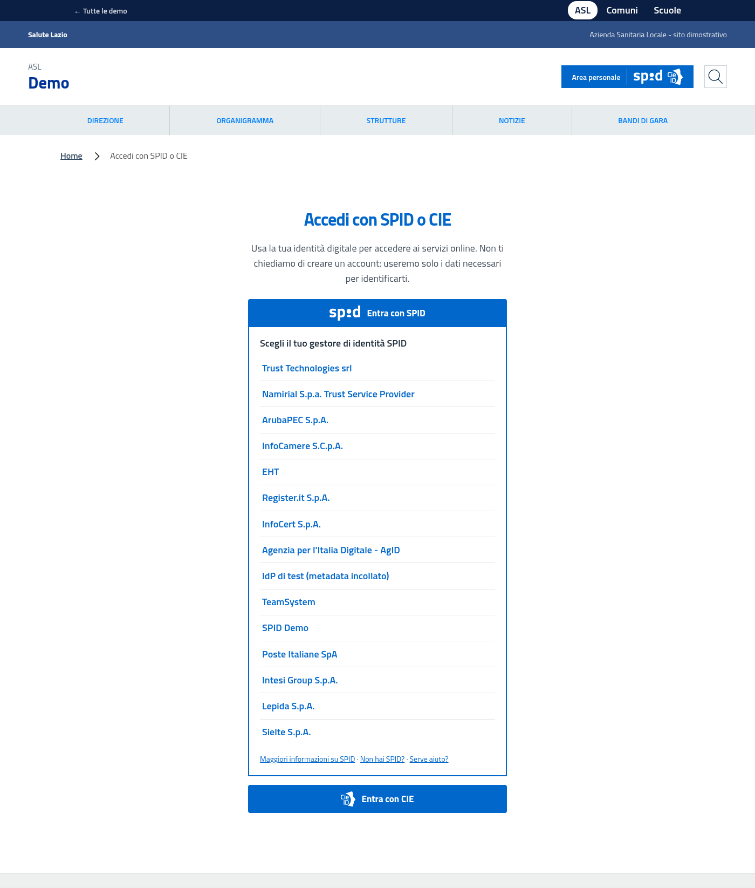
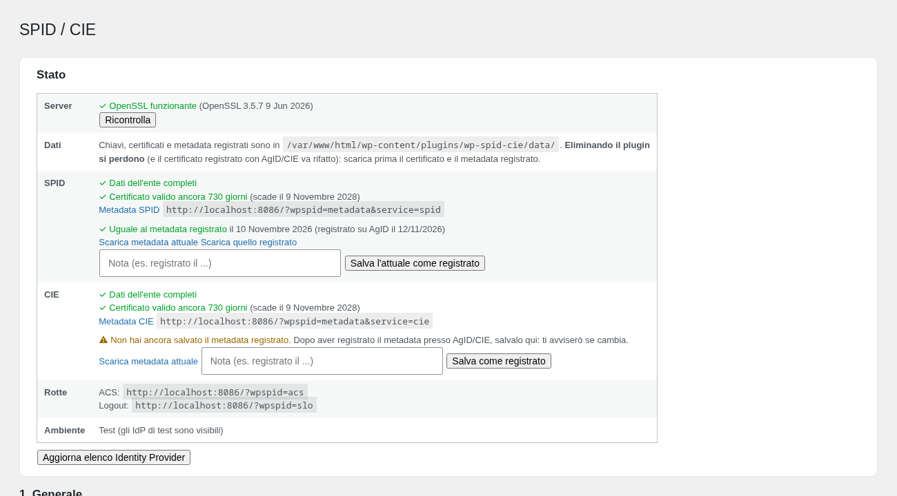
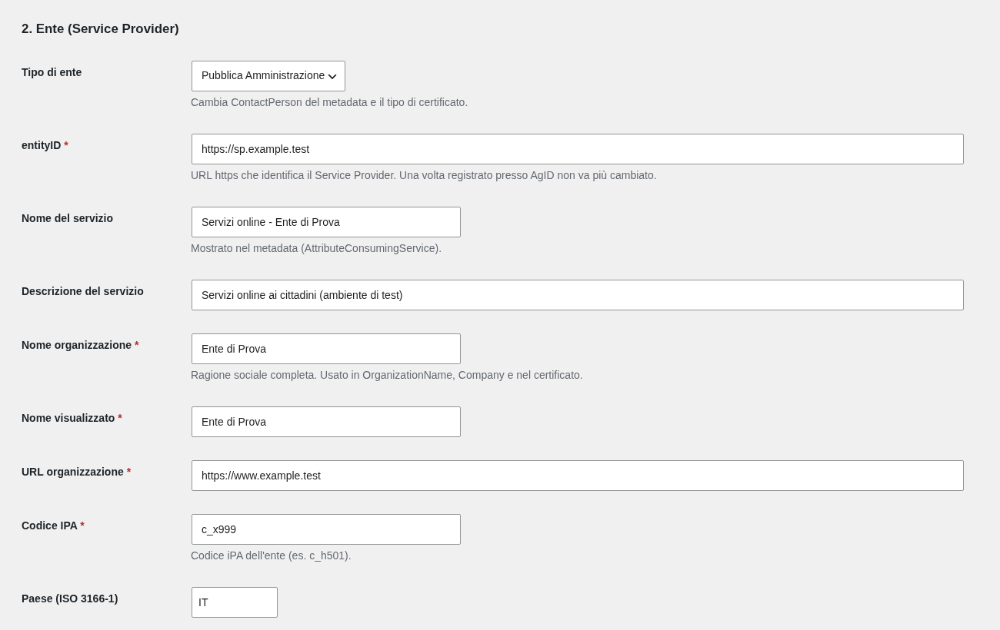

<p align="center"></p>

# Auth SPID CIE

**Accesso con SPID e CIE per WordPress, senza dipendenze.** Un plugin autonomo che trasforma il tuo sito in un *Service Provider* SAML 2.0 per i servizi pubblici: il cittadino si identifica con la sua identità digitale e il sito riceve solo i dati che servono, **senza creare un account WordPress**.

> Versione `0.1.0` in sviluppo. Validato in locale con gli strumenti AgID (`spid-sp-test`, `spid-saml-check`); **non ancora collaudato con gestori d'identità reali né certificato**. Vedi [Stato e limiti](#stato-e-limiti).



## Cosa fa

- **SPID e CIE** (SAML 2.0): AuthnRequest firmate (Redirect e POST), validazione rigorosa delle Response, metadata firmato per l'ente **pubblico o privato** (ContactPerson ed estensioni `spid:`, `fpa:`, `cie:`).
- **Sessione "gate"** per cittadini senza account WordPress: gli attributi SAML sono disponibili al tema e ad altri plugin, con sessione PHP protetta (id rigenerato al login, cookie `HttpOnly`/`SameSite`, durata assoluta).
- **Pulsanti pronti**: `[spid_button]`, `[cie_button]`, `[wpspid_login]` e una pagina di accesso dedicata (`/?wpspid=choose`). Elenco dei gestori in **ordine casuale** e link *Maggiori informazioni / Non hai SPID? / Serve aiuto?* come da linee guida; markup accessibile, senza JavaScript.
- **Integrazione con il tema WP Digital Italia** (e child ASL, Comuni, Scuole): il pulsante *Area personale* dell'header porta al login e, da collegato, mostra il nome del cittadino. Colori ereditati dal tema.
- **Certificati**: generazione dal pannello (soggetto conforme all'Avviso SPID n.29 v.3) o import di chiave e certificato già registrati. Verifica pratica di OpenSSL all'attivazione, con blocco e avviso se il server non è idoneo.
- **Metadata registrato**: salvi il metadata inviato ad AgID/CIE e il plugin ti avvisa se quello attuale è diverso (confronto normalizzato).
- **Nessuna dipendenza**: niente Composer, niente librerie esterne. Solo PHP ≥ 8.0 con `openssl`, `dom`, `libxml`, `mbstring`.

| Pannello di controllo | Dati dell'ente |
|---|---|
|  |  |

## Come funziona

```
Cittadino ──▶ Sito (pulsante "Entra con SPID/CIE")
                │  AuthnRequest firmata
                ▼
          Identity Provider ── il cittadino si autentica ──┐
                                                           │ Response firmata
Sito (ACS) ◀───────────────────────────────────────────────┘
   • verifica firma dell'Assertion, Issuer, Destination, InResponseTo, Audience, tempi
   • consuma una sola volta richiesta e asserzione (anti-replay)
   • apre la sessione con gli attributi (nome, cognome, codice fiscale, ...)
```

## Requisiti

- WordPress (testato su 7.1) e **PHP ≥ 8.0** con le estensioni `openssl`, `dom`, `libxml`, `mbstring` e le funzioni OpenSSL non disattivate dall'hosting.
- Sito servito in **HTTPS** per la produzione (SPID/CIE lo richiedono).

## Installazione

1. Copia la cartella `auth-spid-cie` in `wp-content/plugins/` e attivala. Se il server non può usare OpenSSL l'attivazione viene rifiutata con la causa.
2. **Impostazioni → SPID/CIE**: compila i dati dell'ente (entityID `https://…`, ragione sociale, codice IPA o P.IVA, contatti) e salva.
3. Sezione *Certificati*: **Genera** (o **Importa** quelli già registrati).
4. Dallo *Stato* apri i link al metadata SPID e CIE: sono quelli da registrare. Dopo la registrazione usa **Salva come registrato**.
5. In ambiente di test provi il login con gli IdP di test (SPID Demo, validator AgID, URL personalizzati). In produzione spunta *Ambiente di produzione* (gli IdP di test spariscono).

> Se hai già un SP registrato presso AgID/CIE, **importa** chiave e certificato esistenti invece di rigenerarli: cambiare certificato obbliga a ripetere la registrazione.

## Uso

### Shortcode

```
[wpspid_login]                         pagina di accesso completa (SPID + CIE)
[spid_button return="/area-riservata/"] solo SPID, con l'elenco dei gestori
[cie_button level="2"]                 solo CIE
```

### Funzioni PHP (per temi e altri plugin)

```php
wpspid_is_authenticated();            // bool
wpspid_get_attributes();              // array: name, familyName, fiscalNumber, ...
wpspid_get_attribute( 'fiscalNumber' );
wpspid_login_url( $idp_entity_id, 2, $return_to );
wpspid_logout_url( $return_to );
```

```php
// Proteggere una pagina o un servizio
if ( ! wpspid_is_authenticated() ) {
    wp_safe_redirect( home_url( '/?wpspid=choose&returnTo=' . rawurlencode( get_permalink() ) ) );
    exit;
}
```

### Hook e filtri

| | |
|---|---|
| `do_action( 'wpspid_authenticated', $attributes, null, $idp_entity_id )` | dopo un login valido (es. per registrare l'accesso o creare un utente) |
| `apply_filters( 'wpspid_session_lifetime', 2 * HOUR_IN_SECONDS )` | durata massima della sessione |
| `apply_filters( 'wpspid_logo_url', $url, $service )` | logo dei pulsanti (`'spid'` incluso, `'cie'` fornito dal tema) |

### Integrazione con il tema ASL / WP Digital Italia

Con il tema attivo l'integrazione è automatica (`includes/Integrations/Theme.php`):

- il filtro `dci_area_personale` punta al login e mostra il nome del cittadino da collegato;
- il logo CIE viene preso da `assets/images/identity/cie-bianco.svg` del tema (il plugin non lo include);
- i pulsanti usano i colori del tema: `--wpspid-color`, poi `--asl-link`, poi `--bs-primary`, poi il blu AgID.

## Sicurezza

- Firma XML verificata sull'**elemento specifico** (Assertion): contro *signature wrapping*, ID duplicati, SHA-1, DOCTYPE/entità esterne. Gli attributi si leggono solo dall'Assertion firmata.
- Richiesta e asserzione si consumano **una sola volta** (anti-replay). `Destination`, `Recipient`, `Audience`, livello di garanzia e tempi sono controllati.
- La chiave privata sta in `data/` come file `.php` con guard `<?php exit; ?>`, permessi 0600, `.htaccess`, `index.php`. Il pannello non la mostra mai.
- Gli attributi SAML sono sempre escapati in output.
- **Aggiornare o reinstallare il plugin non cancella i dati** (`data/` viene messa al sicuro e rimessa). **Eliminare il plugin sì**: il certificato registrato va rifatto. Dettagli in [`docs/STORAGE.md`](docs/STORAGE.md).

## Stato e limiti

Cosa è verificato:

- 31 + 138 test automatici (firma/verifica, validazione Response con casi di attacco, certificati, archiviazione, aggiornamento, interfaccia), su PHP 8.0, 8.2, 8.3 e 8.5.
- Metadata validati con `spid-sp-test` 1.2.18: **SPID 110 controlli, 0 falliti; CIE 85 controlli, 0 falliti**.
- Reinstallazione vera su WordPress 7.1 con `wp plugin install --force`: i dati restano identici.

Cosa **non** è ancora fatto o noto:

- **Nessun collaudo con gestori d'identità reali**, né con il validator/demo AgID online, né con la pre-produzione CIE: sono i passi prima della produzione.
- Con `spid-sp-test`: AuthnRequest con `RelayState` mancante (SPID e CIE), firma dell'AuthnRequest CIE non validata dallo strumento, Response con Issuer senza `Format` rifiutata, login CIE simulato rifiutato con l'IdP di test generico. Sono da analizzare.
- Pagina impostazioni, metadata e interfaccia sono in italiano e la traduzione non è ancora predisposta.
- Fuori scopo: eIDAS, modalità proxy/JWT, creazione automatica di utenti WordPress (c'è l'hook `wpspid_authenticated`), multisite con certificati per sito, asserzioni cifrate.

## Sviluppo e test

```bash
php tests/run.php && php tests/run_wp.php          # senza WordPress (stub)
# senza PHP locale:
docker run --rm -v "$PWD":/app -w /app php:8.3-cli sh -c 'php tests/run.php; php tests/run_wp.php'
```

Regola del progetto: ogni nuova regola di validazione parte da un **test negativo**. Per la validazione contro gli strumenti AgID in locale vedi il *testbed* (`spid-testbed/` nel progetto che ospita il plugin): API HTTP su `spid-sp-test` per metadata, AuthnRequest e Response.

```
includes/
  Auth/        sessione "gate" · Cert/ certificati · Http/ rotte (choose, login, acs, slo, metadata)
  Idp/         registro SPID, metadata CIE, IdP di test · Saml/ builder, bindings, validatore, snapshot
  Settings/    pagina admin · State/ richieste e anti-replay · Support/ config, requisiti, salvataggio dati
  Ui/          pulsanti e shortcode · Integrations/ tema · Xml/ firma e verifica
```

## Crediti e licenza

GPL-3.0-or-later. Logo SPID: [italia/spid-graphics](https://github.com/italia/spid-graphics), CC0. Il logo CIE non è incluso (il repository di origine non dichiara una licenza). Le regole tecniche seguite sono quelle di AgID per SPID e del Ministero dell'Interno per la CIE; l'implementazione di riferimento consultata è `spid-cie-php`, il cui codice **non** è incluso.

Autore: Luca Terribili.
